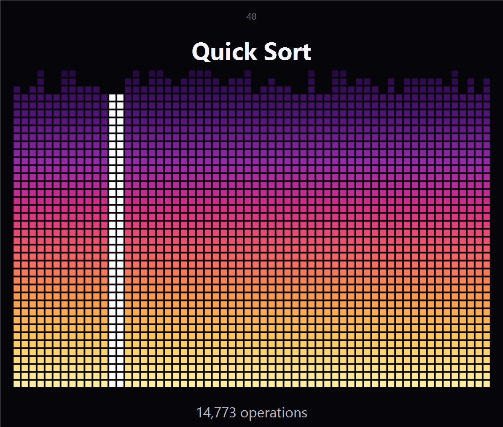
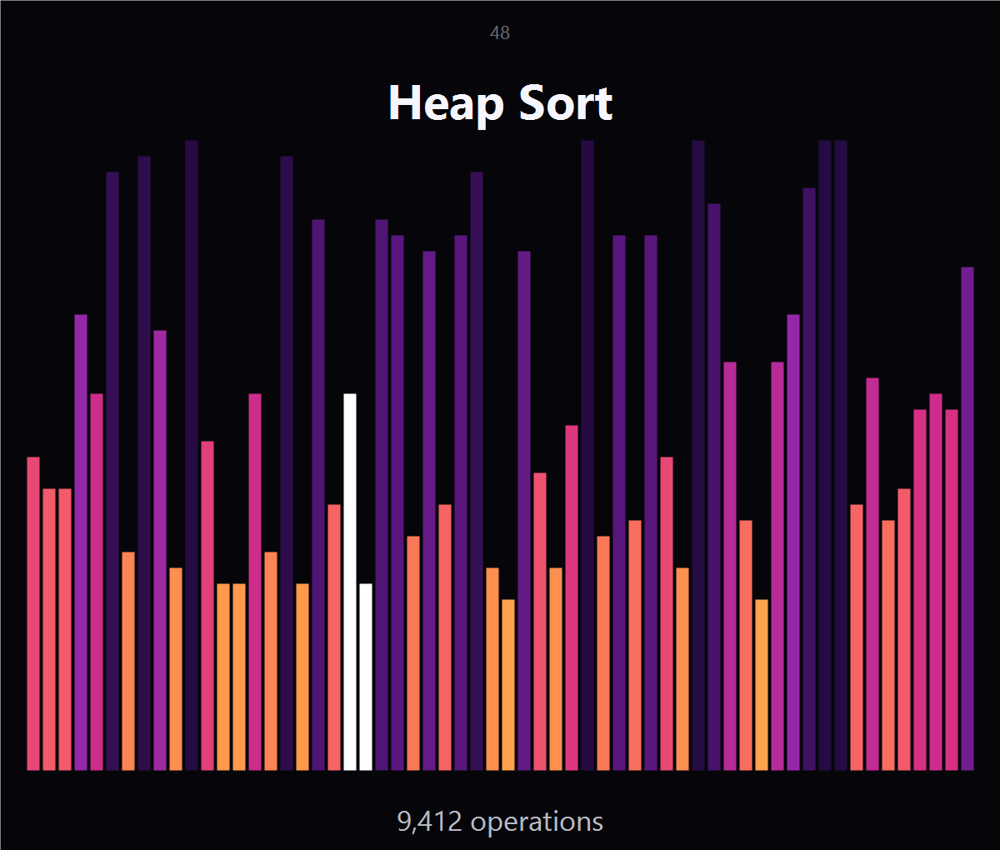

<div align="center">

# Sorting Lab

**Красивый визуализатор сортировок для терминала Windows.**
Тёмный интерфейс, градиентная сетка, живой счётчик операций — и шесть алгоритмов.

[](#требования)
[](#требования)
[](LICENSE)



</div>

---

## Что это

`Sorting Lab` — консольное приложение для Windows PowerShell, которое в реальном
времени показывает, как работают алгоритмы сортировки. Никаких зависимостей:
только PowerShell, ANSI truecolor и блоки `█`.

Вдохновлено тёмными визуализаторами сортировок: градиент от фиолетового к
жёлтому, крупный заголовок алгоритма и счётчик операций внизу.

## Возможности

- **6 алгоритмов:** Bubble, Insertion, Selection, Quick, Merge, Heap.
- **4 визуализации**, переключаются на лету:
  - градиентная сетка квадратиков;
  - вертикальные столбики с плавными полублоками;
  - горизонтальные полосы (с автоматическим делением на панели);
  - точечная матрица.
- **Счётчик операций** — сравнения и обмены/записи за текущий прогон.
- **Подсветка** элементов, которые сравниваются или меняются прямо сейчас.
- **Адаптивная раскладка** — количество столбцов подстраивается под ширину окна.
- **Управление скоростью, пауза, рестарт** — не выходя из анимации.
- Работает в **Windows PowerShell 5.1** и **PowerShell 7+**.

## Быстрый старт

1. Скачайте репозиторий (или только `SortingLab.ps1` и `SortingLab.cmd`).
2. Запустите двойным кликом **`SortingLab.cmd`**.

Либо вручную:

```powershell
powershell -ExecutionPolicy Bypass -File .\SortingLab.ps1
```

> **Совет:** запускайте в [Windows Terminal](https://aka.ms/terminal) — там
> корректно работают UTF-8, блоки и 24-битный цвет. Окно лучше развернуть
> пошире: сетка сама подстроится под ширину.

## Управление

| Клавиши | Действие |
| :--- | :--- |
| `↑` `↓` | выбор пункта меню |
| `←` `→` | сменить алгоритм / визуализацию / скорость |
| `Enter` | старт |
| `Space` | пауза / продолжить |
| `1` `2` `3` `4` | переключить визуализацию на лету |
| `+` / `-` | скорость |
| `R` | перемешать заново |
| `M` / `Esc` | вернуться в меню |
| `Q` | выход |

## Визуализации

### Gradient Grid

Сетка квадратиков: высота столбца — значение, цвет — позиция по вертикали.
Активные элементы подсвечиваются белым.


### Vertical Bars

Столбики с точностью до 1/8 ячейки (`▁▂▃▄▅▆▇█`), цвет зависит от значения.



### Horizontal Bars

Классические горизонтальные полосы. Если значений больше, чем строк в окне,
массив автоматически раскладывается на несколько панелей.

### Dot Matrix

Каждое значение — точка на своей высоте. Хорошо видно, как элементы
«перепрыгивают» друг друга.

## Алгоритмы

| Алгоритм | Среднее | Худшее | Память |
| :--- | :---: | :---: | :---: |
| Bubble Sort | O(n²) | O(n²) | O(1) |
| Insertion Sort | O(n²) | O(n²) | O(1) |
| Selection Sort | O(n²) | O(n²) | O(1) |
| Quick Sort | O(n log n) | O(n²) | O(log n) |
| Merge Sort | O(n log n) | O(n log n) | O(n) |
| Heap Sort | O(n log n) | O(n log n) | O(1) |

## Как это устроено

- Каждый кадр собирается в `StringBuilder` и выводится одним `Write` —
  без `Clear-Host` и мерцания.
- Цвета задаются escape-последовательностями `ESC[38;2;R;G;Bm` (truecolor).
- Анимация ограничена по частоте кадров: операции считаются все, а кадры
  рисуются с заданной частотой — поэтому сортировка не тормозит из-за отрисовки.
- Скорость меняет и частоту кадров, и количество операций на кадр.
- Символы `█ ▁ ░` собираются из кодовых точек, поэтому `.ps1` остаётся
  в чистом ASCII и не ломается при любой кодировке файла.

## Требования

- Windows 10 или Windows 11
- Windows PowerShell 5.1 либо PowerShell 7+
- терминал с поддержкой ANSI truecolor (рекомендуется Windows Terminal)

## Лицензия

[MIT](LICENSE) © 2026 skerdonovandruha-creator
